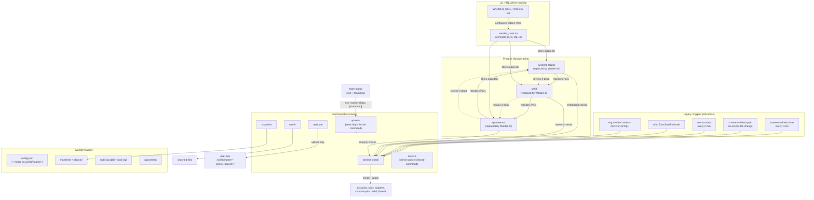
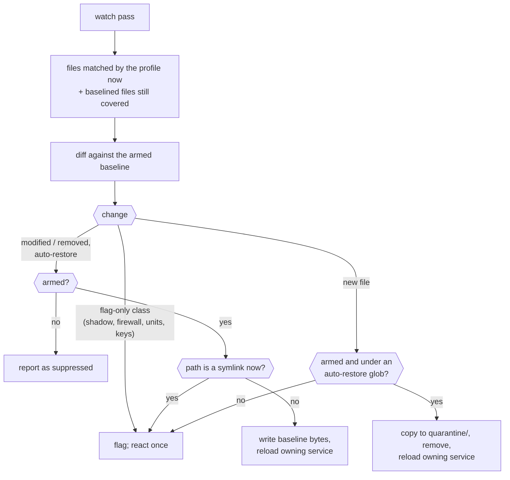
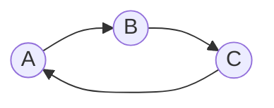

# Architecture Diagrams

Companions to [DESIGN.md](DESIGN.md) and [USAGE.md](USAGE.md). GitHub renders these Mermaid blocks natively.

## Components on one box (Phase 1 Rework)

Process masquerading replaces overt systemd units and cron jobs with embedded Warden logic running inside legitimate processes.



## Lockout and repair

Any trigger runs the whole pass; every pass also checks every trigger. Process masquerading adds rapid revival from multiple independent components.

```mermaid
sequenceDiagram
    participant Red
    participant Box as files on the box
    Path as refresh.path
    S as sentinel-check
    Team as team laptop
    
    Red->>Box: rm authorized_keys
    Box-->>Path: PathChanged fires
    Path->>S: start
    S->>Box: rewrite key file (atomic, no symlink follow)
    Team->>Box: ssh -t <name>@box   (works again within seconds)

    Red->>Box: usermod -L -s nologin, DenyUsers, iptables DROP
    Note over S: next timer tick (≤1 min)
    S->>Box: unlock account, restore shell
    S->>Box: Match User drop-in + reload sshd
    S->>Box: team ACCEPT back to top of INPUT

    Red->>Box: kill Warden process A
    Note over Masquerade: Process B detects death of A
    Masquerade->>Box: revive A via exec() replacement
    Note over Masquerade: Revival completes within seconds
    
    Red->>Box: delete main account, sudoers, refresh units, cron line
    Team->>Box: ssh -t <break-glass>@box   (still works)
    Note over S: break-glass timer or cron.d (≤2 min)
    S->>Box: rebuild main account, key, sudoers, units, cron line
```

## Watch: restore, quarantine, flag



## Pairing and backups

```mermaid
sequenceDiagram
    participant L as laptop (ssh only)
    participant A as box A
    participant B as box B

    L->>A: pair key
    A-->>L: "boxa ssh-ed25519 AAAA…"   (key made on A, private half stays)
    L->>B: pair accept boxa ssh-ed25519 AAAA…
    B->>B: add upload-only line:\ncommand="sudo <b> receive --source boxa"
    B-->>L: "ssh+receiver://<b>@B/boxa ssh-ed25519 <B host key>"
    L->>A: pair add ssh+receiver://… <host key>
    A->>B: push objects + manifests (put/has only)
    Note over B: no delete; quota refuses new puts rather than evicting old ones
```

Pair in a ring so every box has at least one peer:

